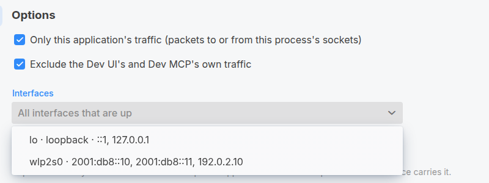

# Quarkus Network Capture

See what your Quarkus application sends and receives on the network, in Wireshark, without leaving dev mode.

The extension adds a **Network Capture** card to the Dev UI. From there you start a capture, use your application, stop, and
open the resulting [pcapng](https://pcapng.com/) file in Wireshark. The capture contains only your application's
traffic: HTTP requests it serves, calls it makes with any client, JDBC, Kafka, Dev Services containers, all of it.

It works on Linux and macOS, needs Java 25, and does not need libpcap or any native library.


## Using it

1. Add the extension to your application:

   ```xml
   <dependency>
       <groupId>io.quarkiverse.networkcapture</groupId>
       <artifactId>quarkus-network-capture</artifactId>
       <version>1.0.0-SNAPSHOT</version>
   </dependency>
   ```

   Nothing else changes. In production builds the extension contributes no code.

2. Run `quarkus dev` and open the Dev UI at `http://localhost:8080/q/dev-ui`. Open the **Capture** page of the
   **Network Capture** card.

   

3. Press **Start capture**. By default the capture covers every network interface that is up, and keeps whatever
   belongs to your application, whether it travels over loopback, a container bridge or the LAN. To capture on
   particular interfaces only, pick them in **Interfaces** first; the picker lists each interface that is up with its
   addresses.

   

   The first time, you will probably see a notice that the application is not allowed to capture. Capturing needs a
   privilege that applications do not normally have. Press the **Start with sudo** (or **pkexec**, or on macOS the
   administrator dialog) button: a small helper process opens the capture for you, asks for your password once, and
   exits. Your application itself never runs with elevated rights. The notice also shows the one-time command that
   makes this prompt go away for good.

   

4. Use your application. The page shows packet counts and a live list of packets as they happen. For plain HTTP,
   the list shows the request line and the status line of each exchange, and the frame types for HTTP/2. Click a
   packet to see the URL, the headers and the body of an HTTP/1.x message. Bodies that arrive in later packets,
   such as the events of a server-sent events response, are decoded too, chunk framing removed. Each response is
   linked to its request, and the Exchange column jumps between the two.

   

5. Press **Stop capture**. The file is listed on the page with a download link, and it is also on disk under
   `target/pcap/`. Open it in Wireshark.

That is all there is to it. A capture keeps running across live reloads and is finished cleanly when dev mode
exits, and the file can be opened in Wireshark while the capture is still running.

## Using it from an AI coding agent

In dev mode, Quarkus can expose a [Dev MCP](https://quarkus.io/guides/dev-mcp) server, and the
[Quarkus Agent MCP](https://quarkus.io/guides/agent-mcp) server proxies it to coding agents such as Claude Code.
The capture is available there as tools, so an agent can look at the actual bytes on the wire instead of guessing
why a call failed: start a capture, exercise the application, read the packets with their decoded HTTP requests and
responses, and stop.

1. Open the Dev UI settings dialog, select the **Dev MCP** tab and enable it; it shows the connection snippet for your
   agent.
2. The tools, under the `quarkus-network-capture_` prefix: `start`, `packets`, `stop`, `status`, `settings` and
   `listFiles` are enabled by default; `deleteFile` has to be enabled on the Dev MCP tab.

The agent's `start` never runs the privileged helper: when the application lacks the capture privilege, the
agent gets `permission-required` and asks you to start the capture from the Dev UI page, or to run the one-time
command that removes the prompt. Elevating stays your decision.

The capture never contains the agent's own Dev MCP requests. What the `packets` tool returns ends up in the agent's
conversation, so it replaces credentials with `[redacted]`: the values of headers such as `Authorization` and
`Cookie` (keeping the authorization scheme and the cookie names), and the values of query parameters such as
`access_token` or `code` wherever a URL appears, including `Location` and `Referer` headers. See
`quarkus.network-capture.redact-headers` and `quarkus.network-capture.redact-query-parameters`. Bodies are returned as
captured. The Dev UI page and the capture files are not redacted. The extension also ships a skill file
(`META-INF/quarkus-skill.md`) that the Agent MCP server hands to agents, describing how the extension and the tools
are used.

## Options

Everything has a sensible default. The settings you are most likely to touch:

| Property | Default | What it does |
| --- | --- | --- |
| `quarkus.network-capture.directory` | `target/pcap` | Where capture files are written. |
| `quarkus.network-capture.application-only` | `true` | Keep only your application's traffic. Turn it off to capture everything on the interface. |
| `quarkus.network-capture.exclude-dev-ui` | `true` | Leave the Dev UI's own traffic out of the file. |
| `quarkus.network-capture.elevation` | `auto` | How the helper gets its privilege: `sudo`, `pkexec` or `osascript`. |
| `quarkus.network-capture.interfaces` | every interface that is up | The interfaces a capture opens, e.g. `lo`; the page preselects them. |
| `quarkus.network-capture.redact-headers` | `authorization`, `cookie`, `x-api-key` and similar | Headers whose values the Dev MCP `packets` tool hides from AI agents; `none` turns it off. |
| `quarkus.network-capture.redact-query-parameters` | `access_token`, `code`, `api_key` and similar | Query parameters whose values the `packets` tool hides; `none` turns it off. |

The two filtering options and the interfaces are also on the page when you start a capture. Less common settings are
`quarkus.network-capture.snap-len`, `quarkus.network-capture.promiscuous` and `quarkus.network-capture.helper-timeout`.

## Good to know

- **TLS traffic is captured encrypted.** Wireshark shows the handshake, not the content.
- **The prompt can be avoided.** On Linux, give the JDK you run dev mode with the capture capability once:
  `sudo setcap cap_net_raw+ep "$(readlink -f "$(which java)")"`. On macOS, Wireshark's installer sets up ChmodBPF,
  which grants your user access to the capture devices.
- **Very short lived connections may be missed** by the application-only filter, a UDP DNS lookup for instance. Turn
  the filter off if you need them.
- **Dev MCP.** The page's backend is described for the Dev MCP server, so an MCP client can start and stop captures
  and list the files once you enable those tools in the Dev UI.
- **macOS** support is written to the documented interfaces but has not been exercised on a Mac yet.

## Under the hood

The capture is done by the `network-capture-core` module through the JDK's Foreign Function & Memory API: an `AF_PACKET`
socket on Linux, a `/dev/bpf` device on macOS. Native access is unavoidable: the JDK has no raw socket API, no
`ioctl`, and no way to pass file descriptors over a Unix domain socket, and all three are needed to capture packets
and hand the privileged descriptor back to the application. The Javadoc of each class links to the specification,
man page or libpcap source it follows. Its API is the `io.quarkiverse.networkcapture` package and nothing else; everything under
`io.quarkiverse.networkcapture.internal` is implementation. The repository has four modules: `core` (the library), `runtime` (the extension,
configuration only), `runtime-dev` (everything behind the Dev UI page, loaded in dev mode only) and `deployment`
(build steps and the page itself). The extension does not require the HTTP layer: an application without it gets
no Dev UI and the page is simply never shown, and the one piece that needs HTTP, the filter and download route behind
the page, is registered only when the layer is present.

## Using the core library directly

The capture library has no dependency on Quarkus and can be used on its own, from `io.quarkiverse.networkcapture:network-capture-core`,
by a JVM started with `--enable-native-access=ALL-UNNAMED`. Its API is the `io.quarkiverse.networkcapture` package. A basic
capture of this process's traffic on every interface that is up looks like this:

```java
Capture.Result opened = Capture.open();
try (CaptureSession session = CaptureSession.start(opened.handles(), ApplicationTrafficFilter.forCurrentProcess())) {
    // ... do work ...
    System.out.println("Wrote " + session.file());
}
```

`Capture.open` opens the interfaces that are up, or the ones it is given, with the default `CaptureOptions` or the
ones it is given: snap length, promiscuous mode, and how privileges are obtained. Interfaces that could not be opened
are listed in `opened.skipped()` with the reason.

`CaptureSession.start` reads from the handles on background threads and writes everything the filter accepts to a
pcapng file. Leave the filter out to capture everything, or pass your own `PacketFilter`. The file is
`capture-<date>-<time>.pcapng` in the working directory unless a path is given, so a new capture never overwrites an
earlier one.

### Privileges

`Capture.open` opens the interfaces directly when the process has the capture privilege. Otherwise it runs the
elevated helper, which may prompt for a password, using the mechanism that `Elevation.detect()` picks for the
machine; the options can name another, or `elevation(null)` to never prompt, in which case a refused open throws
`CapturePermissionException`. `Capture.open` blocks the caller while the helper runs, for at most the options'
helper timeout.

### Threading

A session owns every thread involved, all of them daemon threads: one reader thread per interface that polls the
handle and queues packets, and one writer thread that holds each packet for the filter's hold time, asks the
filter, writes the file and notifies listeners. So a `PacketFilter` or `PacketListener` runs on the writer thread,
one packet at a time and never concurrently with each other; it needs no synchronisation of its own but must not
block, because nothing is written while it runs. The session's other methods may be called from any thread, and
`stop()` blocks until the threads have finished. The library creates no other threads.

## Building

```
mvn install
mvn -pl core test -Dpcap.sudo=true   # also runs the end to end capture test, needs passwordless sudo
```
